# Camper hub

Firmware for the ESP32-2432S028 board (the "Cheap Yellow Display", 320x240 touch screen) as the main screen in a camper van. It reads the solar charger, the power bank and Bluetooth thermometers, shows the weather, helps you park level, keeps a trip diary and can be used from your phone.

<p>
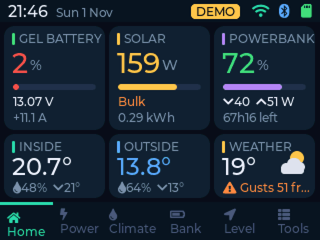
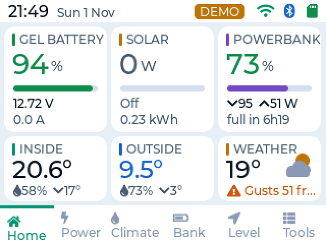
</p>

The screenshots are taken from the board in demo mode (Tools > Settings > Demo), so every page shows values without real devices.

## Pages

**Home.** Six tiles: battery, solar, power bank, inside, outside and weather. Tap a tile to open its page.

**Power.** Live solar power, charger state, battery voltage and current, today's yield and the last 12 hours. Today lists the totals of the day, Days shows the last two weeks.

<p>
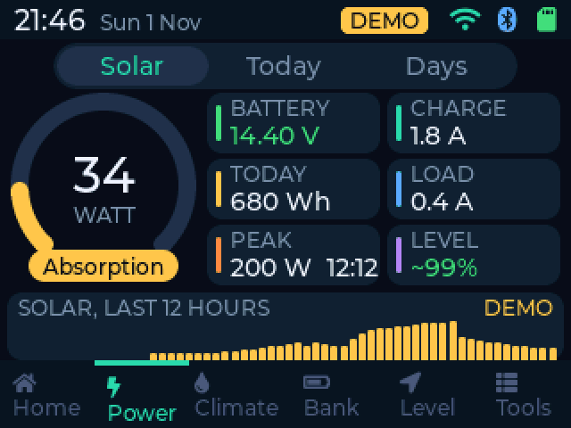
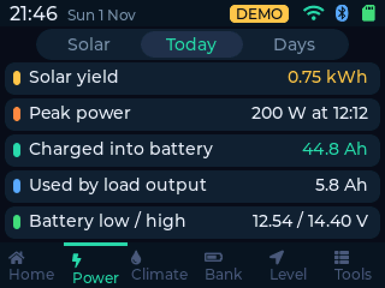
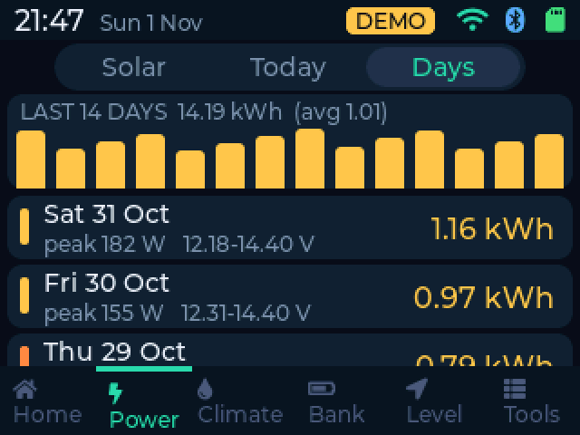
</p>

**Climate.** Thermometers for inside, outside, fridge and freezer, and the forecast for 48 hours and 7 days. The forecast is kept on the SD card, so it still shows without internet. The place follows the board's location or can be pinned to a town.

<p>
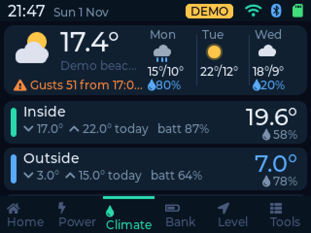
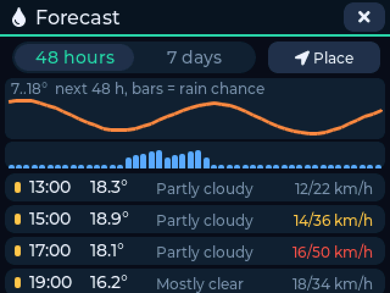
</p>

**Bank.** Fossibot F1200 power bank: charge level, power in and out, time left, switches for USB, 12V, AC and light, and its own settings. The board remembers your own unit, so a neighbour's power bank on a campsite is never used. Bank settings > Forget pairs a new one.

<p>
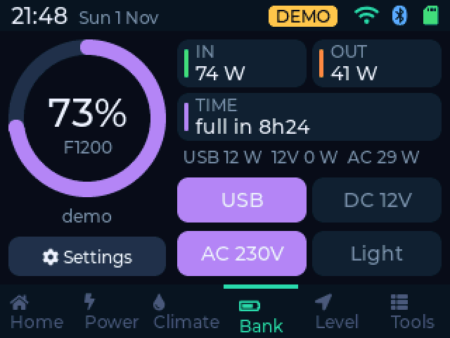
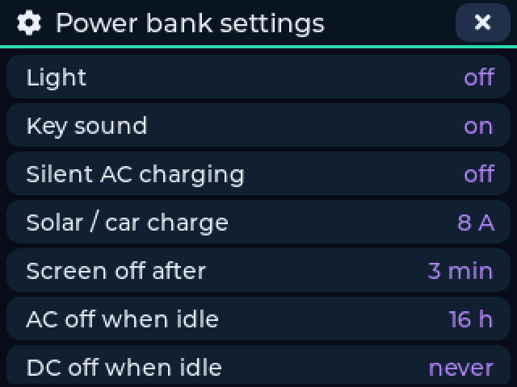
</p>

**Level.** A RuuviTag on the floor shows how level the van stands and how many cm to raise each wheel. Park on level ground once and tap Zero.

**Tools.** Checklists for leaving and arriving (tap to tick, hold to remove), the trip diary with one line per day, and all settings.

<p>
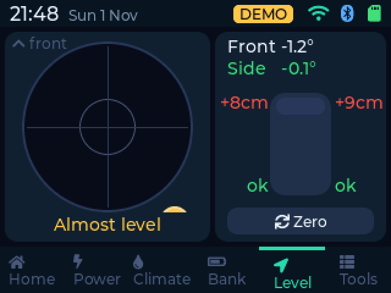
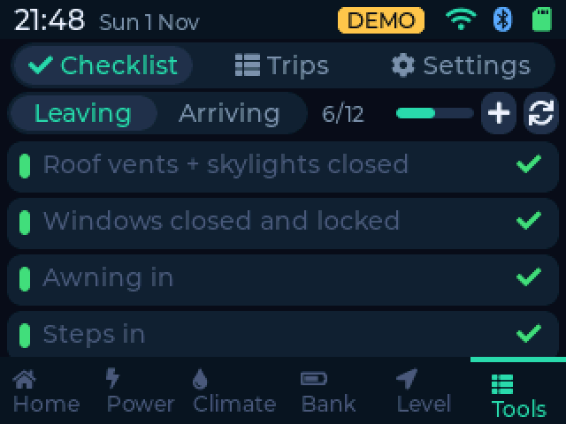
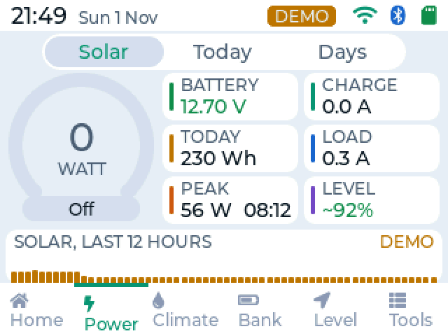
</p>

## Day and night look

Automatic by default: the light look from sunrise to sunset (times from the forecast), the dark look at night. It can also be set to always day or always night in Tools > Settings > Day / night look.

## Screensaver

After a while the screen shows the van under the sky with the clock, battery, solar and outside temperature, or your own photos from the SD card. Photos can be added from the phone page; they are made smaller on the phone before they are sent.

## Phone page

Open the board's address in a browser to see everything and change settings, the checklists, the power bank and the files on the SD card.

* Turn it on or off in Tools > Settings > Phone page (off saves memory)
* User `camper`, the password is shown and can be changed in Tools > Settings > Phone login
* Without campsite WiFi: turn on Own WiFi, join the network `CamperHub` (same password) and open `http://192.168.4.1`

## Devices

* Victron SmartSolar charger over Bluetooth (Instant Readout). Enter its key once: VictronConnect, the charger, gear icon, three dots, Product info, Instant readout details
* Fossibot F1200 power bank (BrightEMS app protocol)
* Thermometers: Xiaomi LYWSD03MMC with pvvx firmware, Shelly BLU H&T and other BTHome sensors, RuuviTag. Tap a sensor to set it as inside, outside, fridge or freezer. A fridge or freezer that is too warm, or a sensor that goes quiet, sounds an alarm
* RuuviTag for the level page

## SD card

Everything is saved in the folder `camper`:

* a log line per minute with all values (`min-DATE.csv`)
* the trip diary (`trips.csv`)
* events, alarms and the last forecast
* a daily settings backup, put back by itself on an empty board
* the screensaver photos (`camper/photos`)

## Updates

Tap Tools > Settings > Update (or "Check now" on the phone page). The board restarts, looks for a new release in this repository and installs `firmware.bin`. A version that keeps crashing is rolled back to the previous one. A firmware file can also be installed from the phone page or from `camper/update.bin` on the SD card.

## Building

PlatformIO: `pio run -t upload`. An optional `include/secrets.hpp` can hold a first WiFi network:

```
#pragma once
#define HOME_SSID "my wifi"
#define HOME_PASS "my password"
```

Release builds leave it out: `tools/release.sh 1.2.0`.

The serial console (115200 baud) has a few test commands, for example `demo` (toggle demo mode), `heap`, `tasks` and `shot` (a screenshot in the exact colours the board draws).
